# Microgrid Optimized Scheduling | Renewable Energy Microgrid Optimized Scheduling in Rural Agricultural Areas (Python Code Implementation)

0 Abstract: Microgrids or local energy production, transmission, and demand distribution systems are now capable of providing electricity to communities in terms of both technology and operation, particularly in rural and suburban areas of developing countries. When designing and evaluating the performance of off-grid hybrid renewable energy microgrids (HREM) for a community, system reliability, generation cost, and operational environmental impact are the main issues. This paper proposes an integrated method for the optimization selection and operation of a HREM consisting of river hydropower, photovoltaic (PV), diesel generators, and battery energy storage systems (BESS) in a rural agricultural community in the southern Philippines. A multi-case power management strategy is also proposed. The three conflicting objective functions minimized are supply probability loss (LPSP), normalized energy cost (LCOE), and greenhouse gas (GHG) emissions, all subject to several constraints. The optimization generated 200 non-dominated or Pareto optimal alternative solutions, four of which were selected as interesting solutions. Based on the results, the optimal size of the system's reliable operating components was found to be 100 panels, with a photovoltaic rated power of 0.25 kW, BESS rated value of 100 kWh, diesel generator rated value of 13 kW, corresponding LCOE, LPSP, and GHG emission values were 0.1795 USD/kWh, 0.05%, and 7874 kg respectively over one year. The effectiveness of the proposed HREM design was also analyzed, yielding many useful findings that can aid in the electrification of the region.
1 Introduction The global energy consumption is exceeding the population growth, which is concerning because it implies the need for more sustainable energy sources[1]. More than 759 million people in developing countries are unable to access electricity, with the demand expected to grow fastest in the coming years. To address this issue, several countries around the world are considering the development of microgrids based on renewable energy to achieve rural electrification and have established mechanisms to encourage the establishment of local energy communities. For example, Poland has decided to establish an Energy Cooperative aimed at bridging the gap in local energy consumption within the community while improving the efficiency of using renewable energy in rural areas and reducing issues related to electrification, aligning with the EU's energy development direction[3]]. A developing country in Southeast Asia, Philippines, is attempting to solve the lack of energy supply and security issues in inactive areas (including all off-grid areas) by formulating policies and plans such as the Comprehensive Electricity Transition Plan (TEP), stimulating the development of renewable energy technologies[4].
Microgrids are a group of distributed power sources and loads that typically operate in conjunction with traditional wide area grids (macrogrids) and are also capable of disconnecting from the interconnected grid when technical or economic conditions require, operating in "island mode" or "off-grid" autonomously[5]]. As microgrids become increasingly popular, with renewable energy technologies such as solar photovoltaics, wind power, and hydropower gaining wider application, traditional energy systems are being modified to incorporate renewable energy[6,7].
In the design and operation of hybrid renewable energy microgrids (HREM), the use of optimization tools is a method that facilitates decision-making in areas where there is significant variability in renewable energy, varying energy demands, and equipment with different performance and cost characteristics. Human resource environmental measures have been evaluated using various performance models, optimization software tools, and techniques, with some findings reported in publications. Using dynamic programming models, the approach described in [8] was used to find the optimal operational strategy for a wind-diesel-battery system within a day, with time steps of 1 hour; meanwhile, in [9], it was employed under thermal and electrical constraints to optimize the operation of the microgrid. To overcome the dimensionality problem of the microgrid, authors in [10] used approximate dynamic programming (ADP) and built an energy management system based on ADP, which includes wind turbines, cooling plants, heat storage, and cooling loads. In [11], a component size technique was developed to determine the optimal hybrid power system design by minimizing the size of batteries and the use of diesel generators, and this model was constructed using annual data on wind and solar energy.
2 Mathematical Model Editing
Integrating photovoltaic systems into HREM structures. Solar cells, also known as photovoltaic cells, are electrical devices that convert solar energy from the sun into electricity for various applications. In a photovoltaic system, the total power generated by each panel constitutes the overall power produced by the system, while the power generation per hour is calculated based on solar radiation and cell temperature. The following equation provides the output power of the photovoltaic system, measured in kilowatts (kW).
Detailed mathematical models are available in Part 4.
3 Case Studies and Operational Results Editing
Edit
Edit
Edit
Edit
Edit
Edit
Edit
Edit
Edit
4 Matlab code and detailed explanation of the article
5 Conclusion This study proposes an optimized design for a decentralized hybrid renewable energy microgrid system, which can meet the electricity load requirements of rural agricultural communities. The Multi-Objective Particle Swarm Optimization (MOPSO) algorithm is used to find the optimal system design and component sizes. The normalized electric cost (COE), power outage probability (LPSP), and greenhouse gas emissions are all objective functions. A sensitivity analysis was also conducted to determine how much the results of the mathematical model vary with changes in the input values of a certain variable. The algorithm generated 200 non-dominated solutions, among which 4 were selected as interesting solutions. Based on the results, the optimal size of the main components for a PV panel with a rated power of 200 kW at 0.25 kW and a BESS of 100 kWh, a diesel generator of 13 kW, was estimated. The estimated system's reliable operation mainly depends on the best size of the main components, compared to the estimated system's LCOE, LPSP, and greenhouse gas emissions of 0.197 USD/kWh, 0.05%, and 7874 kg, respectively, over one year. Using the selected HREM configuration, each component generates enough energy in a month to meet the rural agricultural load and dumping load. The sensitivity analysis shows that the reduction in rural agricultural demand, the number of PV panels, and the size of the BESS leads to higher LCOE values, while the LCOE is least affected by the number of PV panels. Additionally, the main findings and conclusions are as follows:
1. An optimized design for a hybrid renewable energy microgrid (HREM) composed of ROR hydropower, PV, BESS, and diesel generators, considering costs, reliability, and environmental impacts.
2. Considering the intermittency of renewable energy sources while optimizing multiple generator frameworks using MOPSO with three conflicting objectives, namely LCOE, LPSP, and greenhouse gas emissions, along with several constraints and real weather data.
3. The proposed method also determines the capacity of each component in the system, taking into account the availability of renewable energy, load size, and several cost functions to achieve configurations while considering different trade-offs in the lifespan of microgrids to minimize costs and maximize reliability.  
6 References [1] Habib Ur Rahman Habib. Optimal Planning and Integrated Energy Management System for Developing Community Rural Microgrids[D]. Huazhong University of Science and Technology, 2021. DOI: 10.27157/d.cnki.ghzku.2021.003654.  
[2] Wang Tao, Han Jinglin, Shao Hua, He Chunguang, Tan Xiaolin, Yan Yongsheng. Optimization Method for Operation of Rural Microgrid Groups and Power Distribution Network Based on Cooperative Game[J]. Hebei University Journal (Natural Science Edition), 2020, 40(04): 441-448.  
[3] Hao Xuejun. Research on Multi-energy Optimized Capacity Allocation of Rural Microgrids Based on KFCM-WOA Algorithm[D]. Lanzhou University of Technology, 2020. DOI: 10.27206/d.cnki.ggsgu.2020.001204.  
7 End Notes

## Images

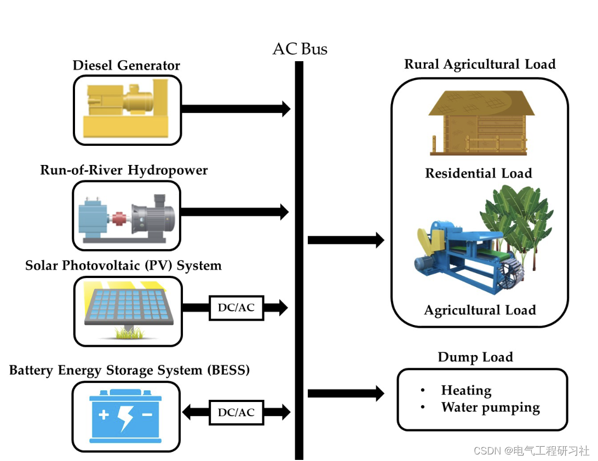
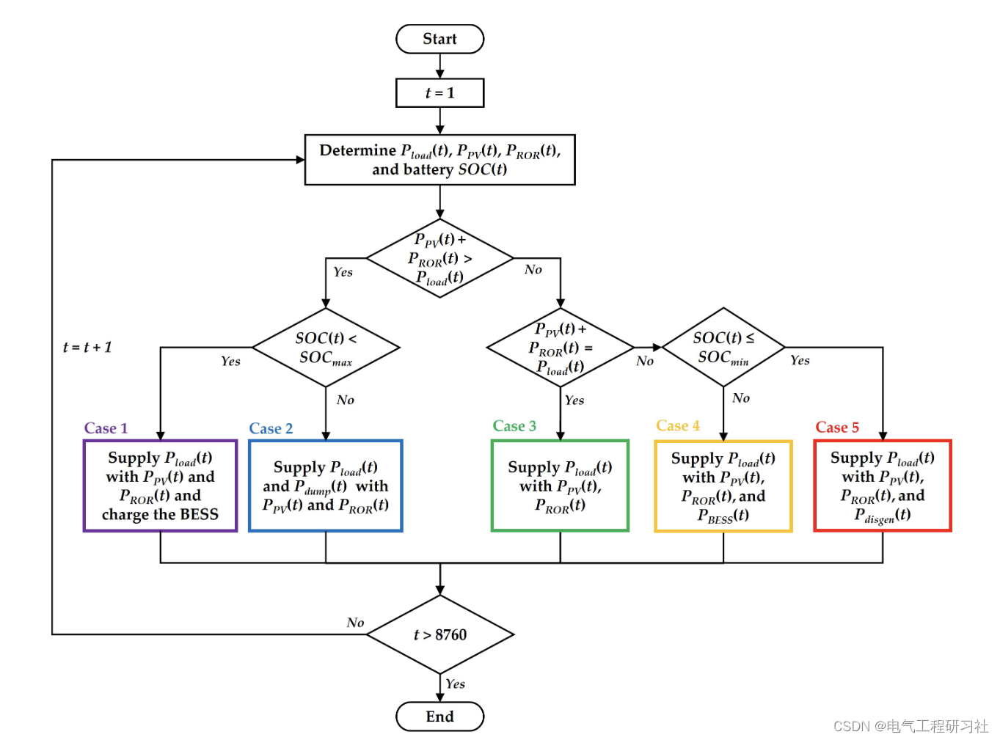
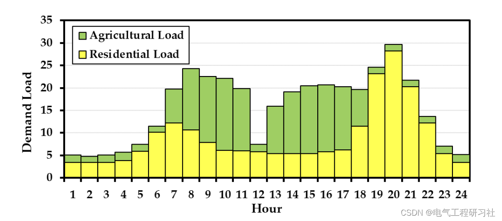
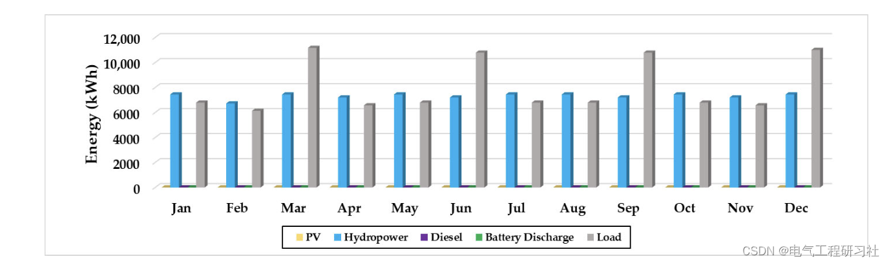
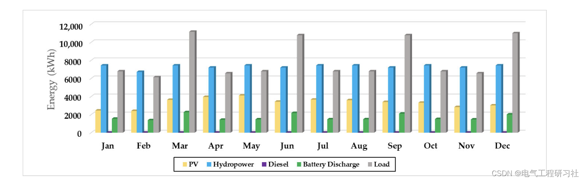
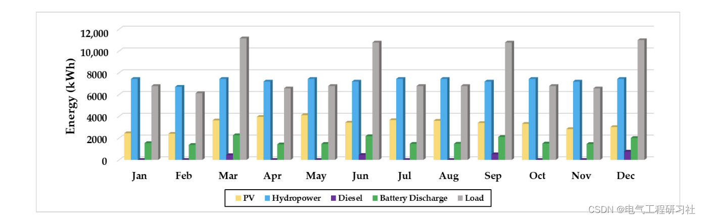
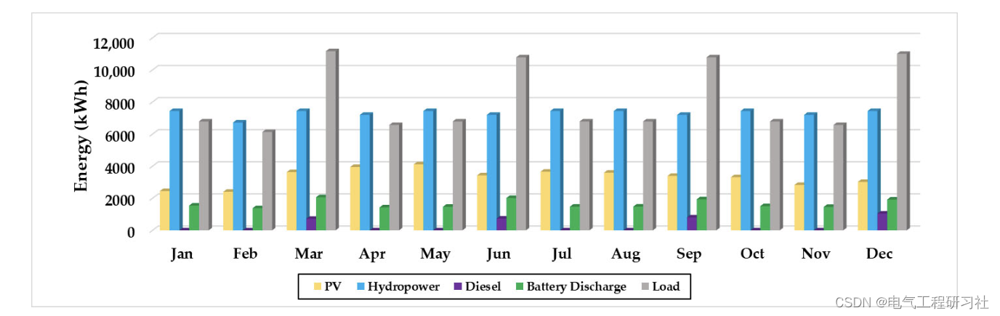
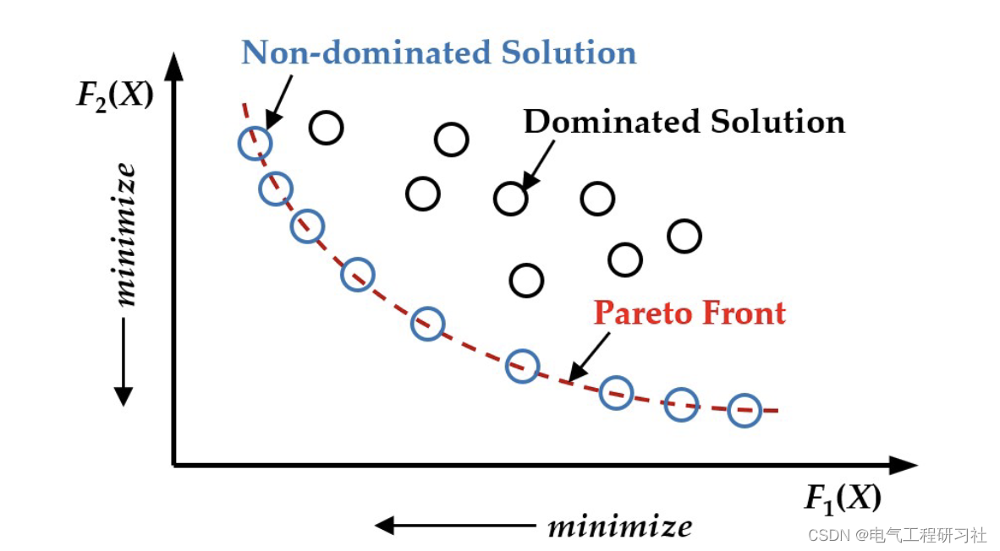
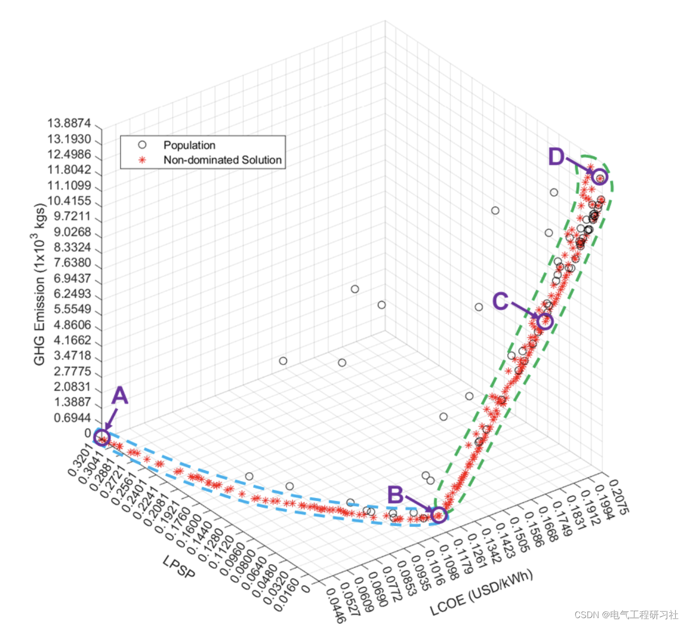
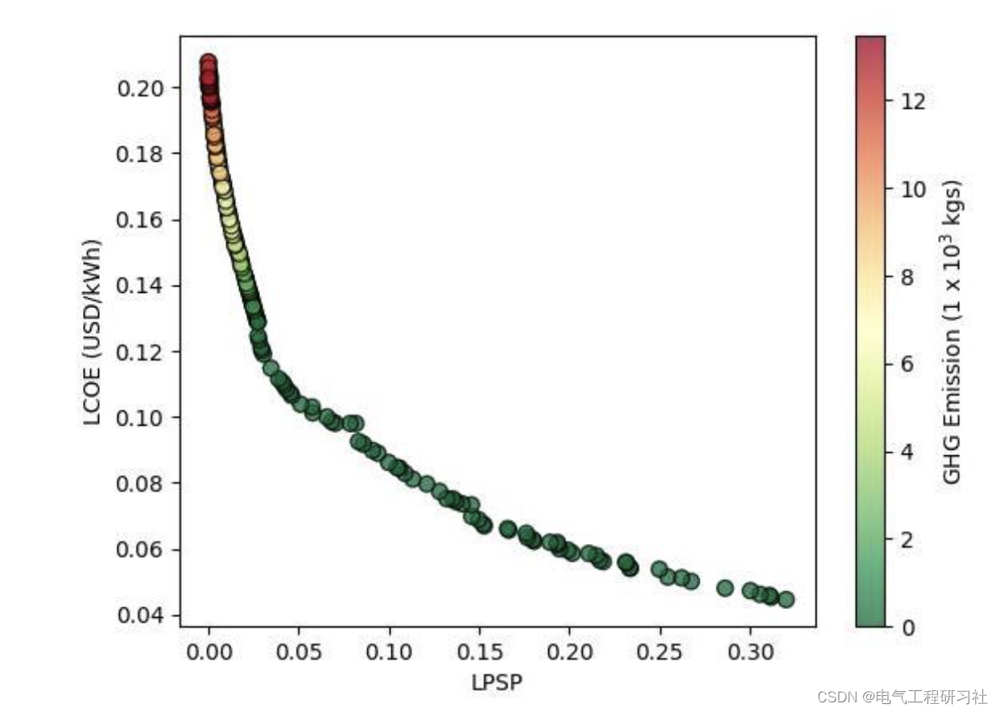
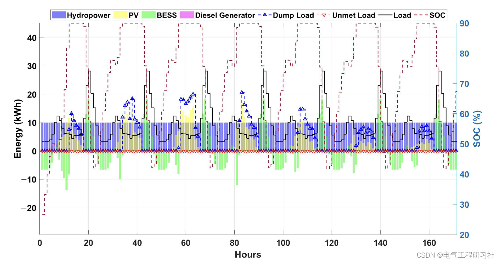
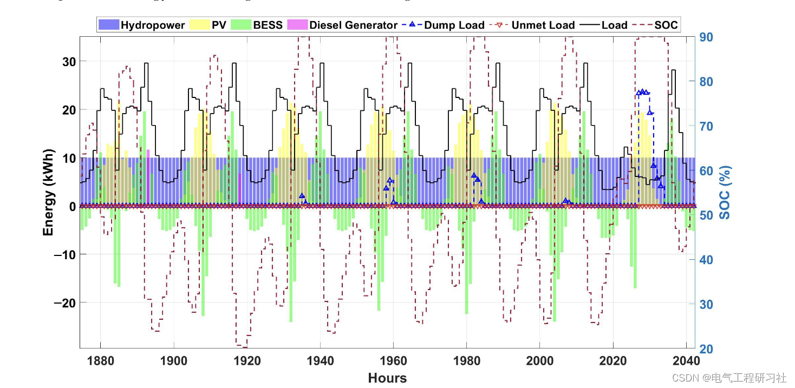

<!-- PAYMENT_BLOCK -->

## Get this dataset

- Payment link (Stripe): [Buy now](https://buy.stripe.com/3cs8yP7sY87d0vu9AB)
- Payment QR code: 

<!-- /PAYMENT_BLOCK -->
